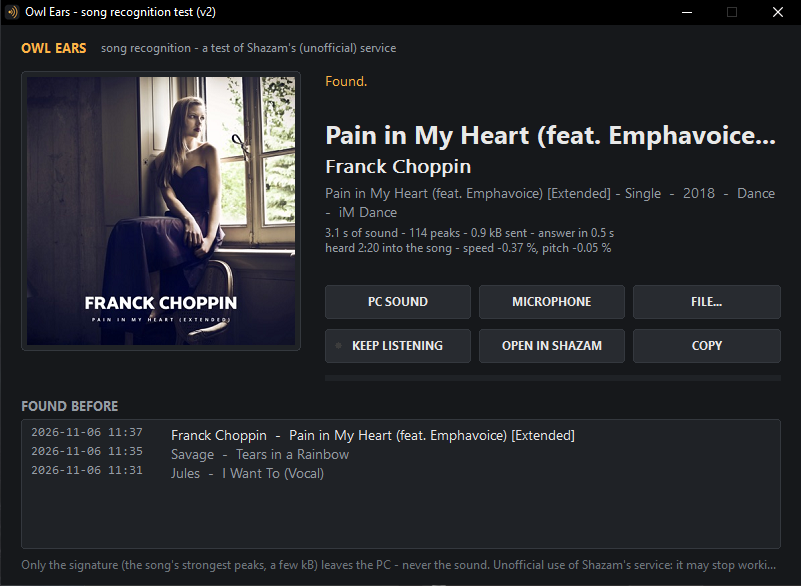

# Owl Ears

**What song is this?** A small Windows song recogniser: one exe, nothing to install. It listens to what your PC plays, to the room through a microphone, or to a music file, and asks Shazam's recognition service what it is.



> **Unofficial.** Owl Ears is not made by, affiliated with or endorsed by Shazam or Apple. It talks to Shazam's service the way Shazam's own app does, through an interface Shazam never published. It may stop working at any time. Use it gently: a few questions now and then, not a flood.

## Download

Get **OwlEars.exe** from [Releases](../../releases), put it anywhere, run it. Windows 10 or 11, 64-bit.

Windows SmartScreen may warn about an unknown publisher (the exe is not signed): *More info → Run anyway*.

## Using it

| Key | What it does |
|---|---|
| **PC SOUND** | What this PC plays (Spotify, a browser, a game, a player), taken digitally from Windows' sound output, no microphone needed |
| **MICROPHONE** | What the room plays (a hi-fi, a radio), from the default recording device. Windows may need *Settings → Privacy → Microphone → let desktop apps use it* |
| **FILE...** | A music file (MP3, FLAC, WAV, OGG): its loudest pieces, from about a third of the way into it |
| **STOP** | The key you pressed turns into STOP while it works |
| **KEEP LISTENING** | After each try, listen again in 20 s: a running log of what plays (the same song twice is written once) |
| **OPEN IN SHAZAM** / **COPY** | The song's page / "Artist - Title" to the clipboard |
| **FOUND BEFORE** | Click the heading to open the log, `%APPDATA%\ThunderOwl\OwlEars\history.txt` |

The first try comes after about 3.5 s of sound. If there is no match, it tries a fresh piece about 3.5 s later, four tries at most.

The answer also says **where in the song** the heard piece was ("heard 2:20 into the song"), and how its **speed and pitch** differ from the record. A tape deck or turntable running slightly off speed, or a sped-up video, shows up there as a small percentage.

## How it works

Owl Ears never sends sound. It sends a **signature**: about 1 kB describing the song's strongest moments.

1. **16 kHz mono.** The sound is reduced to 16 000 samples a second, enough for everything up to 8 kHz.
2. **A spectrogram.** A 2048-sample window (128 ms) slides along in steps of 128 samples (8 ms). Each step gives a power spectrum of 1025 bins, 7.8 Hz apart.
3. **The peaks, or stars.** A bin is kept only if it is the strongest in a wide box around it: about ±80 Hz in frequency, and from about 0.4 s before to 2 s after in time. Room echo, noise and a cheap microphone change how loud everything is. But the brightest points of the music mostly stay the brightest, at the same time and pitch, which is why a song survives the trip through the air.
4. **Each peak keeps** its time, its loudness on a log scale, and its frequency refined to 1/64 of a bin, by fitting a parabola through the bin and its two neighbours.
5. **Three bands.** Peaks are sorted into 250–520 Hz, 520–1450 Hz and 1450–3500 Hz. Below that is room boom and microphone rumble; above it, small microphones and rooms lose the detail.
6. **The match.** Shazam's server holds the same kind of constellations for tens of millions of recordings. Every peak pattern that matches casts a vote for "this song, at this time offset". Random coincidences scatter their votes; the right song piles them up at one offset. The tall spike is both the answer and where in the song you are.

The signature code (`src/ears/signature.h`) is a C++ port of [shazamlite](https://github.com/danielytuk/shazamlite) (MIT). Its output is byte-for-byte identical to the Python original.

## Privacy

- **What leaves the PC:** only the signature, plus a random session ID and the time.
- **What doesn't:** the sound itself, and anything about you.
- **Where it goes:** to `amp.shazam.com`, and to Apple's image server for the cover picture.
- **What stays on the PC:** the history log, a plain text file you can delete at any time.

## Building

```
./build.sh
```

- **Linux:** needs MinGW-w64 (Debian/Ubuntu: `apt install g++-mingw-w64-x86-64`).
- **Windows:** needs MSYS2 (UCRT64 shell: `pacman -S mingw-w64-ucrt-x86_64-gcc`).

The result is `build/OwlEars.exe`, statically linked. The exe on the Releases page is built by GitHub itself from this source (`.github/workflows/release.yml`: *Actions → release → Run workflow*). It uses only the parts Windows always has: WinHTTP for the network, WASAPI through miniaudio for the sound, and GDI for the window.

| File | What |
|---|---|
| `src/main_win.cpp` | The window, listening, asking, the cover |
| `src/ears/signature.h` | The signature (the port) |
| `src/ears/shazam.h` | The request Shazam's app makes, and reading its answer |
| `src/ears/json.h` | A small JSON reader |
| `src/ma_owl.c` | miniaudio and the decoders, compiled once |
| `third_party/` | miniaudio, stb_image, stb_vorbis (public domain) |

## Status, and why it exists

Owl Ears began as a test: is Shazam-style recognition good enough to build into **TA-8090**, a modular late-80s-hi-fi music player and visualiser? It was. TA-8090 now carries the same code as its "Owl Ears" feature, which recognises a turntable on the line input or the radio, and shows the song on its VFD tubes. Owl Ears stays as the small, stand-alone version.

| Version | |
|---|---|
| **v2** | Renamed to Owl Ears (first released as "ThunderEar"); the log moves along by itself |
| **v1** | First version: PC sound / microphone / file, cover, history, KEEP LISTENING, where in the song, speed and pitch |

## Credits

- **The signature format** was first worked out by [SongRec](https://github.com/marin-m/SongRec) (Marin M.).
- **The Python implementations:** ShazamIO, then [shazamlite](https://github.com/danielytuk/shazamlite) (Daniel Richard Todd Back), which this C++ port follows.
- **Libraries:** [miniaudio](https://miniaud.io) by David Reid; [stb](https://github.com/nothings/stb) by Sean Barrett.
- **Owl Ears** by Thunder Owl ([@Juris3D](https://github.com/Juris3D)), written with Claude. MIT licence; see `licenses/` for the others.
